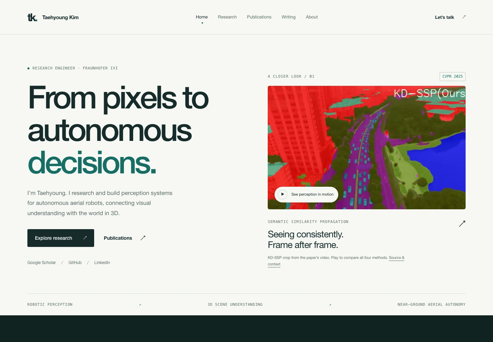

# Research portfolio redesign - review

Implemented on `feat/research-portfolio-hybrid-2026`, from `f366916`. Main remains at that original commit. No push, merge, deployment, or GitHub Pages setting change was made.

## Preview

```sh
npm ci
npm run build
npm run dev
```

Open `http://127.0.0.1:4173`. The preview server serves public site files and blocks source/private-reference directories. The live GitHub Pages site remains unchanged until the branch is approved and published.



| Viewport         | Before                                        | After                                        |
| ---------------- | --------------------------------------------- | -------------------------------------------- |
| Desktop, 1440 px | [Original](screenshots/home-before-1440.webp) | [Redesign](screenshots/home-after-1440.webp) |
| Tablet, 768 px   | [Original](screenshots/home-before-768.webp)  | [Redesign](screenshots/home-after-768.webp)  |
| Phone, 390 px    | [Original](screenshots/home-before-390.webp)  | [Redesign](screenshots/home-after-390.webp)  |

Other page previews: [Research](screenshots/projects-1440.webp), [Publications](screenshots/publications-1440.webp), [Writing](screenshots/writing-1440.webp), [Applied Work](screenshots/work-1440.webp).

## What changed

- Research-first light editorial homepage with authentic SSP video, dark selected-research gallery, research directions, real-map demonstration preview, professional context, About and direct contact.
- Current research foregrounded; older thesis work and personal experiments retained in an archive. Optional independent-project registry ready for future ventures.
- One publication registry drives the homepage, research page, scholarly index, citation export and accurate scholarly metadata.
- Markdown articles with readable technical typography, syntax-highlighted code, tables, RSS, social metadata and automatic homepage previews. Writing intentionally starts empty.
- Applied Work includes only public professional/institutional context. No new personal project responsibility or institutional accomplishment was inferred.
- Small build-time Eleventy setup, safe root export, a preview server, pinned dependencies, publishing instructions, responsive assets, page metadata, sitemap, favicon and 404 page.

## Verification

- `npm run build`, `npm run check`, `npm run lint`, `npm run test:publishing` pass.
- Full Playwright run: **49 passed**, **2 intentionally skipped** (mobile-only menu test on desktop/tablet), no retries. Covers all six new page types, desktop/tablet/phone, existing paper routes, citation filters/copying, video loading, no JavaScript, reduced motion and WebGL fallback.
- After typography polish, all **18 responsive page/accessibility checks** passed again at 1440/768/390 px.
- Axe WCAG A/AA checks found no violations on the six new page types at all three viewports. A temporary, unpublished article fixture was also checked at 1440 and 390 px: no violations or horizontal overflow. Code blocks, headings, tables and callouts were visually reviewed.
- Publishing tests build an actual Markdown article, verify escaped metadata, highlighted code, table rendering, homepage/RSS/sitemap inclusion, draft/future exclusion, and safe removal after unpublishing. Export safeguards reject unexpected routes and handwritten overwrites/deletions.
- External link audit: 13 destinations returned HTTP 200. LinkedIn returned its HTTP 999 automation block, so that existing profile URL could not be automatically verified.
- Every local generated-page link, fragment and responsive image path resolves. RSS and sitemap parse as XML. One h1 per generated HTML page and valid JSON-LD verified.
- VoxelFix real scene/model loading, keyboard camera input, comparison modes, changed-only filtering and camera reset tested. Pixel captures verify that moving the input camera changes all three rendered views together; the strengthened synchronization test passed at all three viewports. Forced WebGL failure retains the paper and displays the existing fallback message.
- Read-only comparison against `f366916` confirms all tracked `publications/` files, verification HTML, `.nojekyll`, and license files are unchanged.
- Dependency audit: zero known vulnerabilities. The preexisting untracked teaser remains unmodified and excluded from commits.

## Performance

Lighthouse 13.5.0, local static preview, default mobile and desktop presets. These are single lab measurements, not deployed field/Core Web Vitals guarantees. Full summaries are in [metrics.json](metrics.json).

| Metric                     | Before desktop | After desktop | Before mobile | After mobile |
| -------------------------- | -------------- | ------------- | ------------- | ------------ |
| Performance                | 93             | 100           | 67            | 99           |
| Accessibility              | 72             | 100           | 59            | 100          |
| Best practices             | 96             | 100           | 96            | 100          |
| SEO                        | 91             | 100           | 91            | 100          |
| Largest contentful paint   | 1.3 s          | 0.4 s         | 5.9 s         | 2.0 s        |
| Cumulative layout shift    | 0              | 0             | 0             | 0            |
| Transfer size during audit | 1,079 KiB      | 231 KiB       | 1,079 KiB     | 430 KiB      |

The homepage does not fetch the SSP video, legacy GIFs, voxel datasets, or a 3D library on initial navigation. Responsive AVIF/WebP figures replace heavy animated previews. Fonts are system-local; the new portfolio has no third-party runtime requests or analytics.

## Content and media decisions

MultiFly uses the user-confirmed current 14-author roster, three equal-contribution markers, correspondence attribution, and 2026 preprint status. Its code/data and project links remain absent. The official Figure 1 is credited under CC BY-NC-SA 4.0. See the [asset ledger](asset-manifest.md).

SSP hero imagery is an explicitly described crop from the existing video, not a new experimental result. The complete four-method comparison is available on demand. A slider is omitted because a clean, verified aligned RGB/mask pair was not established. The deeper 3D interaction remains the original VoxelFix viewer, avoiding a second implementation or misleading synthetic data.

## Remaining inputs and limits

Only optional content remains: an authentic portrait/current CV, a verified matched-frame comparison, stable MultiFly release links, and cleared institutional project contributions. Details are in [content-questions.md](content-questions.md). No fake posts or publicly visible placeholder project cards were added.

Validation used Chromium/Chrome, including touch emulation and software-rendered WebGL. Physical-device Safari/Firefox and production network/field metrics were not measured. No INP field claim is made. The Writing page remains empty until you author a real post; private drafts must stay uncommitted as documented in the README.

Review the feature branch and screenshots before approving any merge or production publication.
